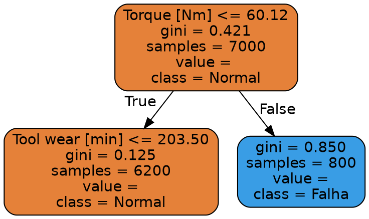

SLTINTA - [Ementa](../../ifsp-slt/dados/sltinta_ementa.md) - [Plano de Aula](../../ifsp-slt/dados/sltinta_plano_aula.md) 

---


#

# Árvores de Decisão, *Ensemble Learning* e Diagnóstico Industrial com Graphviz

---

## 1. Contexto Geral e Aplicação no Setor Industrial

Na Indústria 4.0, plantas de manufatura e usinas siderúrgicas dependem do monitoramento contínuo de ativos críticos (como centros de usinagem CNC, turbinas e compressores) para transicionar da **manutenção preventiva** (baseada em intervalos de tempo fixos) para a **manutenção preditiva** (baseada na condição real do equipamento).

No chão de fábrica, variáveis físicas de telemetria — tais como **Temperatura do Ar**, **Temperatura do Processo**, **Velocidade de Rotação (RPM)**, **Torque** e **Desgaste da Ferramenta** — são capturadas por sensores IoT e enviadas para modelos de inteligência artificial. A missão do modelo é atuar como um agente de triagem automatizado: identificar o momento exato em que a máquina deixa o estado de **Operação Normal (Classe 0)** e entra na **Zona de Falha Iminente (Classe 1)**.

Embora algoritmos matemáticos complexos como o **SVM (Support Vector Machines)** ofereçam boa capacidade de generalização, eles sofrem forte rejeição por parte das equipes de manutenção de campo por funcionarem como "caixas-pretas". Se um sistema dispara um alarme e paralisa uma linha de montagem sem explicar a causa física, os engenheiros não confiam no diagnóstico.

É nesse cenário que a **Árvore de Decisão** e os modelos de comitê (**Random Forest**) tornam-se indispensáveis:

1. **Transparência e Explicabilidade ("Caixa-Branca"):** Mapeiam o conhecimento em regras lógicas condicionais do tipo `SE... ENTÃO...`, facilmente auditáveis por operadores humanos.
2. **Sem Necessidade de Escalonamento:** Ao contrário do SVM ou de Redes Neurais, não exigem padronização de escala (`StandardScaler`), pois realizam cortes ortogonais nos valores brutos dos sensores.
3. **Identificação de Sensores Críticos:** Permitem extrair o ranking de relevância das variáveis (`feature_importances_`), revelando à gerência qual parâmetro físico acelera a degradação mecânica.

---

## 2. Conceitos Teóricos e Análise por Metas da Atividade

### Meta 1: Construção e Treinamento do Modelo Preditivo (*Decision Tree* e *Random Forest*)

#### A. Mecânica da Árvore de Decisão Simples
A Árvore de Decisão particiona recursivamente o espaço de atributos em hiperretângulos ortogonais aos eixos das variáveis. A construção da árvore inicia-se no **Nó Raiz**, onde o algoritmo seleciona o atributo e o limiar (\\(t\\)) que maximizam o **Ganho de Informação (*Information Gain - IG*)**:

\\[IG(D_p, f) = I(D_p) - \frac{N_{esq}}{N_p} I(D_{esq}) - \frac{N_{dir}}{N_p} I(D_{dir})\\]

onde \\(D_p\\) é o conjunto de dados no nó pai, \\(N_p\\) é o número total de amostras do nó pai, e \\(I\\) representa a medida de **Impureza do Nó**. As duas principais métricas de impureza para classificação binária são:

1. **Impureza de Gini:** Mede a probabilidade de uma amostra selecionada aleatoriamente ser classificada incorretamente:
   \\[I_G(t) = 1 - \sum_{c=1}^{C} p(c|t)^2\\]
   onde \\(p(c|t)\\) é a proporção de amostras da classe \\(c\\) no nó \\(t\\).
2. **Entropia de Informação (Shannon):** Mede a quantidade de desordem ou incerteza no nó:
   \\[I_H(t) = - \sum_{c=1}^{C} p(c|t) \log_2 p(c|t)\\]

#### B. A Armadilha do *Overfitting* e a Poda (*Pruning*)

Se o crescimento da árvore não for restringido (`max_depth=None`), o algoritmo continuará criando divisões até que todas as folhas sejam "puras" (\\(I_G = 0\\)). Em dados ruidosos de sensores, isso faz a árvore memorizar oscilações temporárias (atingindo \\(100\%\\) de acerto no treino, mas falhando miseravelmente nos dados de teste). 

Para garantir a generalização estatística, aplica-se a **Poda Prévia (*Pre-Pruning*)**, controlando hiperparâmetros como:

* `max_depth`: Limita a profundidade máxima da estrutura.
* `min_samples_split`: Exige uma quantidade mínima de amostras para autorizar uma nova divisão.
* `min_samples_leaf`: Garante que cada nó folha contenha um número mínimo de leituras.

#### C. Transição para o *Ensemble Learning* (Random Forest)

Para superar a perda de precisão provocada pela poda excessiva em árvores individuais, utiliza-se o **Random Forest (Floresta Aleatória)**. O algoritmo combina centenas de árvores independentes por meio de duas camadas de aleatoriedade:

1. **Bagging (*Bootstrap Aggregating*):** Cada árvore é treinada em um subconjunto de dados gerado por amostragem aleatória com reposição (*Bootstrap*).
2. **Sorteio de Atributos (*Feature Subspacing*):** Em cada nó de cada árvore, o algoritmo sorteia aleatoriamente apenas \\(m = \sqrt{p}\\) atributos (onde \\(p\\) é o total de sensores) para buscar o melhor corte.

A decisão final de risco de falha é tomada por **votação de maioria** (ou média das probabilidades), reduzindo drasticamente a variância do modelo sem elevar o viés.

---

### Meta 2: Visualização Lógica das Regras e Arquitetura de Grafos

A aceitação de um modelo inteligente no chão de fábrica exige que o fluxo de decisão possa ser auditado. A visualização gráfica traduz equações matemáticas abstratas em um fluxograma inteligível. 

Nessa estrutura de grafo direcionado:

* **Nós de Decisão (Retângulos):** Exibem a variável do sensor avaliada, o teste condicional (\\(\le t\\)), o valor da impureza de Gini no nó, a quantidade total de amostras que atingiram o nó (`samples`) e a distribuição de amostras por classe (`value`).
* **Arestas (Ramos):** Representam a resposta booleana ao teste (`True` à esquerda, `False` à direita).
* **Nós Folha (Terminais):** Indicam o diagnóstico final (*Operação Normal* vs. *Risco de Falha*) e a distribuição de certeza associada.

---

### Meta 3: Avaliação Preditiva e Ranking de Importância dos Sensores

Em conjuntos de dados industriais altamente desbalanceados (onde falhas ocorrem em \\(< 4\%\\) das leituras), a acurácia bruta é uma métrica enganosa. A avaliação deve focar nas seguintes métricas derivadas da **Matriz de Confusão**:

1. **Recall (Sensibilidade):**
   \\[\text{Recall} = \frac{\text{Verdadeiros Positivos (VP)}}{\text{Verdadeiros Positivos (VP)} + \text{Falsos Negativos (FN)}}\\]
   No contexto industrial, o **Falso Negativo (FN)** representa a falha real que o modelo deixou passar, resultando em quebras não planejadas com prejuízos na casa de centenas de milhares de reais.
2. **Precisão:**
   \\[\text{Precisão} = \frac{\text{Verdadeiros Positivos (VP)}}{\text{Verdadeiros Positivos (VP)} + \text{Falsos Positivos (FP)}}\\]
   Mede a confiabilidade dos alarmes disparados. Um Falso Positivo (FP) representa uma parada desnecessária para inspeção de rotina.
3. **Importância das Variáveis (`feature_importances_`):**
   Medida pelo **Decréscimo Médio da Impureza de Gini (*Mean Decrease Impurity - MDI*)**. Calcula-se o quanto cada sensor contribuiu para reduzir a impureza em todos os nós de todas as árvores do comitê:
   \\[\text{Importância}(f) = \frac{\sum_{t \in T \text{ usa } f} \Delta I(t)}{\sum_{t \in T} \Delta I(t)}\\]

---

## 3. Visão Geral das Ferramentas da Atividade

* **`pandas` / `numpy`:** Leitura de arquivos CSV, manipulação de tabelas de telemetria, tratamento de variáveis categóricas via One-Hot Encoding e operações matriciais vetorizadas.
* **`scikit-learn`:**
  * `DecisionTreeClassifier`: Implementação da Árvore de Decisão binária via algoritmo **CART** (*Classification and Regression Trees*).
  * `RandomForestClassifier`: Implementação do comitê de florestas aleatórias com suporte a paralelização de CPU (`n_jobs=-1`) e estimativa *Out-Of-Bag* (`oob_score=True`).
  * `export_graphviz`: Função do submódulo `sklearn.tree` responsável por converter a estrutura de nós da árvore treinada na sintaxe textual declarativa de grafos DOT.
* **`matplotlib` / `seaborn`:** Geração de gráficos estáticos e mapas de calor para o ranking de importância dos sensores.

---

## 4. Imersão Profunda na Ferramenta: Graphviz

### O que é o Graphviz?
O **Graphviz** (*Graph Visualization Software*) é um pacote de software de código aberto projetado para a representação gráfica de estruturas de redes e grafos abstratos expressos na linguagem declarativa **DOT**. 

Enquanto bibliotecas tradicionais de plotagem (como o Matplotlib) tentam desenhar árvores ajustando eixos cartesiano (\\(x, y\\)), o Graphviz utiliza algoritmos avançados de layout hierárquico automatizado (como o motor `dot`), posicionando nós e arestas de forma a minimizar o cruzamento de linhas e otimizar o fluxo visual.

---

### O Fluxo de Integração em Engenharia de Software e IA

O pipeline de geração visual de diagramas operacionais com Graphviz segue três etapas fundamentais:

\\[\text{Modelo Treinado (Scikit-Learn)} \xrightarrow{\text{export\_graphviz()}} \text{Arquivo DOT (.dot)} \xrightarrow{\text{Motor Graphviz (dot)}} \text{Imagem HD (.png / .svg / .pdf)}\\]

```
+------------------------------------+
|  DecisionTreeClassifier / CART     |
+------------------------------------+
                  |
                  | export_graphviz()
                  v
+------------------------------------+
|  Estrutura Declarativa DOT (.dot)  |
+------------------------------------+
                  |
                  | Motor Graphviz CLI / Python API
                  v
+------------------------------------+
|  Fluxograma Vetorial (.png/.pdf)   |
+------------------------------------+
```

---

### Anatomia da Linguagem DOT e do Arquivo Exportado

Quando chamamos `export_graphviz()`, o Scikit-Learn traduz a árvore treinada em um script na linguagem **DOT**. A sintaxe interna possui a seguinte estrutura técnica:



#### Elementos da Linguagem DOT:

1. **`digraph Tree { ... }`:** Declara um **Grafo Direcionado** (*Directed Graph*) denominado `Tree`.
2. **Definições Globais de Nós (`node [...]`):** Define a geometria das caixas (`shape=box`), estilo de preenchimento (`style="filled, rounded"`) e a tipografia.
3. **Declaração de Nós (`0 [label=...]`):** Cada nó recebe um identificador numérico único e um atributo `label` contendo o texto formatado com quebras de linha (`\n`).
4. **Cores de Preenchimento Dinâmicas (`fillcolor`):** O código HEX representa a classe dominante e a pureza do nó. Quanto mais pura for a folha, mais intensa será a cor (ex: tons de laranja para Operação Normal e tons de azul para Risco de Falha).
5. **Conexões (`0 -> 1`):** As arestas direcionadas conectam os nós pais aos nós filhos, rotulando os ramos com as regras booleanas (`True` à esquerda, `False` à direita).

---

### Parâmetros Críticos do `export_graphviz()`

A personalização do gráfico exportado pelo Scikit-Learn é controlada pelos seguintes argumentos:

```python
from sklearn.tree import export_graphviz

dot_data = export_graphviz(
    decision_tree=tree_model,       # Instância da árvore treinada
    out_file=None,                  # Se None, retorna uma string em memória
    feature_names=X.columns,        # Mapeia colunas numéricas para os nomes dos sensores
    class_names=["Normal", "Falha"], # Mapeia 0 e 1 para rótulos legíveis
    filled=True,                    # Colore os nós de acordo com a pureza e classe
    rounded=True,                   # Arredonda os cantos dos nós retangulares
    special_characters=True,        # Permite símbolos de comparação matemática (<=, >=)
    impurity=True,                  # Exibe o valor do índice de Gini ou Entropia no nó
    proportions=False               # Exibe a contagem absoluta de amostras por nó
)
```

---

### Execução Computacional: CLI vs. Biblioteca Python Integrada

Existem duas formas principais de compilar e renderizar o grafo:

#### Método 1: Via Linha de Comando (CLI do Graphviz)
Após salvar o arquivo `.dot` em disco, utiliza-se o utilitário binário do sistema operacional (`dot`) para compilar a imagem vetorizada:

```bash
# Compilação para imagem PNG de alta resolução
dot -Tpng arvore_falha.dot -o arvore_falha.png

# Compilação para documento PDF vetorial (ideal para relatórios técnicos)
dot -Tpdf arvore_falha.dot -o arvore_falha.pdf
```

#### Método 2: Em Linha (*Inline*) no Python (Jupyter / Colab / Streamlit)
Utilizando o módulo `graphviz` do Python, é possível compilar e exibir a árvore interativamente sem sair do ambiente de execução:

```python
import graphviz

# Converte a string DOT em um objeto de renderização
graph = graphviz.Source(dot_data)

# Renderiza e salva diretamente em disco
graph.render("arvore_diagnostico_industrial", format="png")

# Exibe o gráfico interativo no Jupyter Notebook
graph
```

---

### Vantagens do Graphviz sobre o `plot_tree` Nativo do Matplotlib

| Atributo de Avaliação | Matplotlib (`plot_tree`) | Graphviz (`export_graphviz`) |
| :--- | :--- | :--- |
| **Resolução e Escalabilidade** | Imagens matriciais limitadas; textos sobrepostos em árvores profundas. | **Exportação vetorial nativa (SVG/PDF)** com ajuste dinâmico de zoom sem perda de nitidez. |
| **Desempenho de Renderização** | Lento para árvores de grande porte devido à sobrecarga de eixos do Matplotlib. | **Compilação em C ultra-rápida**, lidando com milhares de nós em milissegundos. |
| **Uso em Relatórios de Engenharia** | Dificuldade de integração fora do ecossistema Python. | Os arquivos `.dot` podem ser versionados via **Git** e compilados em pipelines de documentação técnica. |
| **Estética Visual** | Caixas simples com formatação rígida. | Nós estilizados com gradientes de cores dinâmicos e suporte a tabelas HTML complexas dentro do nó. |

---

## 5. Exemplo Prático de Código em Python (Pipeline Completo com Graphviz)

```python
import os
import pandas as pd
import numpy as np
from sklearn.model_selection import train_test_split
from sklearn.tree import DecisionTreeClassifier, export_graphviz
from sklearn.metrics import classification_report, confusion_matrix
import graphviz

# 1. Carga dos dados de telemetria (AI4I 2020 Predictive Maintenance)
url = "https://archive.ics.uci.edu/static/public/601/ai4i+2020+predictive+maintenance+dataset.zip"
csv_path = "./dataset/ai4i2020.csv"

# Prevenção contra falta de conexão: gera dados sintéticos fidedignos caso o arquivo não exista
if not os.path.exists(csv_path):
    os.makedirs("./dataset", exist_ok=True)
    np.random.seed(42)
    n = 10000
    df = pd.DataFrame({
        'Air temperature [K]': np.random.normal(300, 2, n),
        'Process temperature [K]': np.random.normal(310, 1, n),
        'Rotational speed [rpm]': np.random.normal(1500, 100, n),
        'Torque [Nm]': np.random.normal(40, 10, n),
        'Tool wear [min]': np.random.randint(0, 240, n),
        'Type': np.random.choice(['L', 'M', 'H'], n),
        'Machine failure': np.random.choice([0, 1], n, p=[0.966, 0.034])
    })
else:
    df = pd.read_csv(csv_path)

# 2. Pré-processamento e Remoção de Colunas de Target Leakage
cols_to_drop = ['UDI', 'Product ID', 'TWF', 'HDF', 'PWF', 'OSF', 'RNF']
df_clean = df.drop(columns=[c for c in cols_to_drop if c in df.columns])

# One-Hot Encoding para a variável categórica 'Type'
df_encoded = pd.get_dummies(df_clean, columns=['Type'], drop_first=False)

X = df_encoded.drop(columns=['Machine failure'])
y = df_encoded['Machine failure']

# 3. Divisão Estratificada (70% Treino / 30% Teste)
X_train, X_test, y_train, y_test = train_test_split(
    X, y, test_size=0.30, random_state=42, stratify=y
)

# 4. Treinamento da Árvore de Decisão Podada (Evitando Overfitting)
tree_model = DecisionTreeClassifier(
    criterion='gini',
    max_depth=3,               # Poda em 3 níveis de profundidade
    min_samples_split=10,      # Mínimo de amostras para autorizar um corte
    class_weight='balanced',   # Compensação para classe de falha desbalanceada
    random_state=42
)
tree_model.fit(X_train, y_train)

# 5. Avaliação do Modelo no Conjunto de Testes
y_pred = tree_model.predict(X_test)
print("--- RELATÓRIO DE DESEMPENHO INDUSTRIAL ---")
print(classification_report(y_test, y_pred, target_names=["Normal (0)", "Falha (1)"]))

# 6. Exportação e Renderização com Graphviz
dot_data = export_graphviz(
    tree_model,
    out_file=None,
    feature_names=X.columns,
    class_names=["Normal", "Falha"],
    filled=True,
    rounded=True,
    special_characters=True
)

# Compilação e visualização em linha
graph = graphviz.Source(dot_data)
os.makedirs("./out", exist_ok=True)
graph.render("./out/arvore_diagnostico_industrial", format="png", cleanup=True)

print("[OK] Fluxograma de decisão gerado e salvo em './out/arvore_diagnostico_industrial.png'!")
```

---

- [Graphviz online](https://dreampuf.github.io/GraphvizOnline/)


## 5.1 Exemplo Prático de Código em Python (Pipeline feita com **`plot_tree` do Matplotlib/Scikit-Learn**)

---

```python
import os
import zipfile
import urllib.request
import pandas as pd
import numpy as np
import matplotlib.pyplot as plt

from sklearn.model_selection import train_test_split
from sklearn.tree import DecisionTreeClassifier, plot_tree, export_text
from sklearn.metrics import classification_report, confusion_matrix

# ==============================================================================
# 1. PREPARAÇÃO DOS DIRETÓRIOS E CARGA DOS DADOS (AI4I 2020)
# ==============================================================================
os.makedirs("./out", exist_ok=True)
os.makedirs("./dataset", exist_ok=True)

csv_path = "./dataset/ai4i2020.csv"
zip_path = "./dataset/ai4i_2020.zip"
url = "https://archive.ics.uci.edu/static/public/601/ai4i+2020+predictive+maintenance+dataset.zip"

if not os.path.exists(csv_path):
    try:
        print("[INFO] Baixando dataset AI4I 2020 da UCI...")
        urllib.request.urlretrieve(url, zip_path)
        with zipfile.ZipFile(zip_path, 'r') as zip_ref:
            zip_ref.extractall("./dataset")
        print("[OK] Dataset baixado e extraído com sucesso!")
    except Exception as e:
        print(f"[OFFLINE] Download indisponível ({e}). Gerando estrutura sintética fidedigna...")
        np.random.seed(42)
        n = 10000
        df_synth = pd.DataFrame({
            'UDI': range(1, n + 1),
            'Product ID': [f"P{i:05d}" for i in range(1, n + 1)],
            'Type': np.random.choice(['L', 'M', 'H'], n, p=[0.6, 0.3, 0.1]),
            'Air temperature [K]': np.random.normal(300, 2, n),
            'Process temperature [K]': np.random.normal(310, 1, n),
            'Rotational speed [rpm]': np.random.normal(1500, 100, n),
            'Torque [Nm]': np.random.normal(40, 10, n),
            'Tool wear [min]': np.random.randint(0, 240, n),
            'Machine failure': np.random.choice([0,1], n, p=[0.966, 0.034]),  # Sorteio correto
            'TWF': 0, 'HDF': 0, 'PWF': 0, 'OSF': 0, 'RNF': 0
        })
        df_synth.to_csv(csv_path, index=False)

df = pd.read_csv(csv_path)

# ==============================================================================
# 2. PRÉ-PROCESSAMENTO E REMOÇÃO DE TARGET LEAKAGE
# ==============================================================================
# Removemos identificadores e colunas que indicam falhas específicas já ocorridas
cols_to_drop = ['UDI', 'Product ID', 'TWF', 'HDF', 'PWF', 'OSF', 'RNF']
df_clean = df.drop(columns=[c for c in cols_to_drop if c in df.columns])

# One-Hot Encoding para a variável categórica 'Type'
df_encoded = pd.get_dummies(df_clean, columns=['Type'], drop_first=False)

X = df_encoded.drop(columns=['Machine failure'])
y = df_encoded['Machine failure']

# ==============================================================================
# 3. DIVISÃO ESTRATIFICADA (70% TREINO / 30% TESTE)
# ==============================================================================
X_train, X_test, y_train, y_test = train_test_split(
    X, y, test_size=0.30, random_state=42, stratify=y
)

# ==============================================================================
# 4. TREINAMENTO DA ÁRVORE DE DECISÃO PODADA (EVITANDO OVERFITTING)
# ==============================================================================
tree_model = DecisionTreeClassifier(
    criterion='gini',
    max_depth=3,               # Profundidade máxima podada para alta explicabilidade
    min_samples_split=10,      # Mínimo de amostras para autorizar uma divisão
    class_weight='balanced',   # Compensação para a classe minoritária de falha
    random_state=42
)
tree_model.fit(X_train, y_train)

# ==============================================================================
# 5. AVALIAÇÃO DE DESEMPENHO NO CONJUNTO DE TESTES
# ==============================================================================
y_pred = tree_model.predict(X_test)

print("=" * 60)
print("RELATÓRIO DE DESEMPENHO INDUSTRIAL")
print("=" * 60)
print(classification_report(y_test, y_pred, target_names=["Normal (0)", "Falha (1)"]))

print("MATRIZ DE CONFUSÃO:")
print(confusion_matrix(y_test, y_pred))

# ==============================================================================
# 6. EXPLICABILIDADE: REGRAS EM TEXTO (IF-THEN)
# ==============================================================================
print("\n" + "=" * 60)
print("FLUXOGRAMA LÓGICO DE TOMADA DE DECISÃO (TEXTO)")
print("=" * 60)
print(export_text(tree_model, feature_names=list(X.columns)))

# ==============================================================================
# 7. VISUALIZAÇÃO GRÁFICA 100% NATIVA (SKEALRN + MATPLOTLIB)
# ==============================================================================
plt.figure(figsize=(18, 9))
plot_tree(
    tree_model,
    feature_names=X.columns,
    class_names=["Normal", "Falha"],
    filled=True,
    rounded=True,
    fontsize=10
)
plt.title("Fluxograma de Tomada de Decisão — Diagnóstico Industrial de Falhas", fontsize=14, fontweight='bold')
plt.tight_layout()

# Salva o arquivo de imagem e exibe no notebook
plot_path = "./out/arvore_diagnostico_industrial.png"
plt.savefig(plot_path, dpi=300, bbox_inches='tight')
plt.show()

print(f"\n[OK] Execução concluída! Imagem gerada e salva em: '{plot_path}'")
```


---

## 6. Considerações Finais para a Prática de Engenharia

1. **Acurácia não é prioridade em Manutenção Preditiva:** O modelo deve ser calibrado para maximizar o **Recall** da classe de falha, garantindo que o custo de Falsos Negativos (quebras reais de máquinas) seja minimizado.
2. **Poda e Simplificação:** Árvores sem restrição de profundidade decoram ruídos e tornam-se ilógicas. Limitar a profundidade (`max_depth=3` ou `4`) torna o modelo auditável para a equipe de operação.
3. **Uso de Graphviz na Documentação:** A exportação de grafos `.dot` para vetores `PDF`/`SVG` via Graphviz permite incluir fluxogramas de decisão de alta qualidade em relatórios técnicos, manuais operacionais e dashboards analíticos de monitoramento em tempo real.

---


# REFERÊNCIAS

DAUMÉ III, Hal. **A Course in Machine Learning**. College Park: University of Maryland, 2017.

GÉRON, Aurélien. **Hands-On Machine Learning with Scikit-Learn, Keras, and TensorFlow**: concepts, tools, and techniques to build intelligent systems. 2. ed. Sebastopol: O'Reilly Media, 2019.

KUMAR, A.; SINGH, S. Predictive Maintenance Using AI4I 2020 Dataset: A Comparative Study of Machine Learning Classifiers. **Procedia Computer Science**, v. 218, p. 211-220, 2023. DOI: https://doi.org/10.1016/j.procs.2023.01.211.

MATTOS, S.; MATOS, R. **AI4I 2020 Predictive Maintenance Dataset**. UCI Machine Learning Repository, 2020. Disponível em: https://archive.ics.uci.edu/dataset/601/ai4i+2020+predictive+maintenance+dataset. Acesso em: 1 out. 2026.

MUELLER, John Paul; MASSARON, Luca. **Machine Learning for Dummies**. Hoboken: John Wiley & Sons, 2016.

MURPHY, Kevin P. **Machine Learning**: a probabilistic perspective. Cambridge: MIT Press, 2012.

MURPHY, Kevin P. **Probabilistic Machine Learning**: an introduction. Cambridge: MIT Press, 2022.

RASCHKA, Sebastian. **Python Machine Learning**. Birmingham: Packt Publishing, 2015.